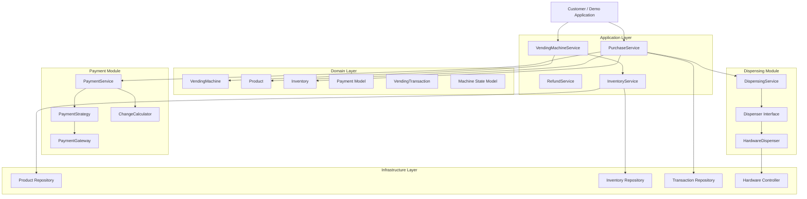
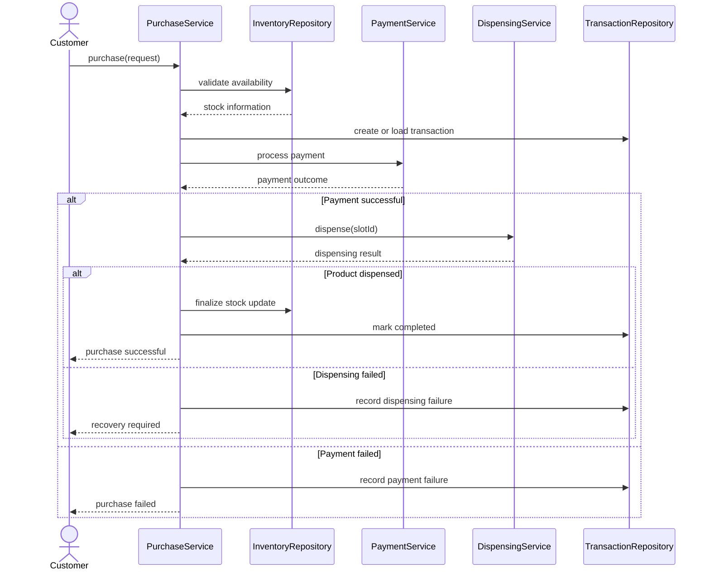
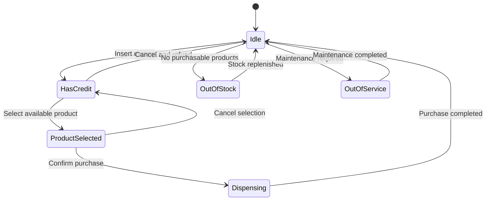

# Vending Machine System — Low-Level Design in Java

A production-oriented vending machine system designed using Java, object-oriented design principles, SOLID, established design patterns, and clean architectural boundaries.

The project models the core business workflows of an automated vending machine, including product selection, inventory management, payment processing, purchase transactions, product dispensing, refunds, and machine monitoring.

The primary objective is to demonstrate how to translate real-world requirements into a maintainable, extensible, and testable object-oriented system.

> Project type: Low-Level Design (LLD) / Object-Oriented Design  
> Language: Java  
> Build tool: Maven  
> Architecture: Modular, layered Java application  
> Testing: JUnit 5  
> Status: In development

---

## Table of Contents

- [Overview](#overview)
- [Problem Statement](#problem-statement)
- [Design Goals](#design-goals)
- [Functional Requirements](#functional-requirements)
- [Non-Functional Requirements](#non-functional-requirements)
- [System Capabilities](#system-capabilities)
- [Technology Stack](#technology-stack)
- [Architecture](#architecture)
- [Package Structure](#package-structure)
- [Core Domain Model](#core-domain-model)
- [Design Patterns](#design-patterns)
- [Purchase Workflow](#purchase-workflow)
- [Payment Processing](#payment-processing)
- [Inventory Management](#inventory-management)
- [State Management](#state-management)
- [Error Handling and Recovery](#error-handling-and-recovery)
- [Concurrency and Idempotency](#concurrency-and-idempotency)
- [Hardware Abstraction](#hardware-abstraction)
- [Testing Strategy](#testing-strategy)
- [Running the Project](#running-the-project)
- [Example Execution](#example-execution)
- [Engineering Decisions and Trade-offs](#engineering-decisions-and-trade-offs)
- [Security Considerations](#security-considerations)
- [Observability and Monitoring](#observability-and-monitoring)
- [Future Enhancements](#future-enhancements)
- [Learning Outcomes](#learning-outcomes)
- [Contributing](#contributing)
- [License](#license)

---

## Overview

A vending machine appears simple from the outside: select a product, pay for it, and receive the item.

Internally, however, a reliable vending machine must coordinate several independent responsibilities:

- Product catalog management
- Inventory availability
- Purchase lifecycle management
- Payment authorization and collection
- Cash change calculation
- Hardware-controlled product dispensing
- Transaction recording
- Refund handling
- Machine availability and maintenance

These responsibilities introduce interesting design challenges involving state transitions, failure handling, concurrency, and consistency.

This project explores these challenges through a modular Java implementation.

The system is designed to make business rules explicit and keep domain logic independent of implementation details such as storage mechanisms and hardware integrations.

### Engineering principles

The design emphasizes:

- Encapsulation and composition
- Single Responsibility Principle (SRP)
- Open/Closed Principle (OCP)
- Dependency Inversion Principle (DIP)
- Interface-based abstractions
- Explicit state transitions
- Separation of business logic from infrastructure
- Testability through dependency substitution
- Clear transaction boundaries
- Safe handling of external failures

The use of these principles does not automatically make the application production-ready. Production deployment would additionally require appropriate persistence, security, observability, concurrency controls, and operational validation.

---

## Problem Statement

Design a vending machine that allows customers to purchase products from available inventory using supported payment methods.

The machine must validate product availability, verify payment, coordinate dispensing, and maintain transaction information.

The design should also support administrative operations such as restocking inventory and checking machine health.

The system should be extensible enough to introduce new payment methods, dispensing hardware, product categories, and persistence implementations without rewriting the core purchase workflow.

### Example scenario

Assume a machine contains:

| Attribute | Value |
|---|---|
| Machine ID | `VM-001` |
| Product | Cola |
| Product ID | `COLA` |
| Price | ₹15.00 |
| Slot ID | `A1` |
| Initial stock | 5 |
| Customer payment | ₹20.00 |
| Expected change | ₹5.00 |

The machine should validate the selection, process the payment, dispense the product, update inventory, record the transaction, and return the appropriate result.

If any operation fails, the system must follow a defined failure-handling policy rather than blindly repeating the purchase.

---

## Design Goals

### 1. Extensibility

The system should support new payment strategies and hardware implementations through interfaces.

For example, adding a new payment method should not require modifying the inventory domain model.

### 2. Maintainability

Each class should have a clearly defined responsibility.

Business rules should not be duplicated across controllers, payment adapters, inventory repositories, and hardware implementations.

### 3. Testability

Core business logic should be testable without requiring a physical vending machine or external payment provider.

Mock implementations should allow deterministic testing of success and failure scenarios.

### 4. Failure isolation

Payment failures, storage failures, inventory conflicts, and dispensing failures should be distinguishable.

A failure in one subsystem should not automatically trigger an unsafe retry in another.

### 5. Explicit business rules

The system should clearly define:

- Which machine states permit product selection
- When inventory is reserved or decremented
- When payment is considered successful
- When a transaction is completed
- How cancellation and refunds are handled

### 6. Operational readiness

The architecture should provide a reasonable foundation for transaction logging, machine health monitoring, and future integration with persistent storage and hardware devices.

---

## Functional Requirements

### Customer operations

- Browse or select an available product.
- Insert cash or use another supported payment method.
- Validate the selected product and its price.
- Confirm the purchase.
- Receive the product after successful dispensing.
- Cancel a purchase when cancellation is permitted.
- Receive a refund when required by the transaction outcome.
- Receive a meaningful error when the purchase cannot be completed.

### Inventory operations

- Maintain product quantities by slot.
- Retrieve inventory information.
- Detect empty slots.
- Prevent invalid stock updates.
- Support restocking operations.
- Associate each inventory slot with a product.

### Payment operations

- Accept supported payment methods.
- Validate payment amounts.
- Calculate change for cash purchases.
- Record payment outcomes.
- Support refund processing.
- Handle unsuccessful payment attempts.

### Administrative operations

- Monitor machine status.
- Identify empty slots.
- Restock inventory.
- Place a machine into or take it out of service.
- Inspect transaction and payment outcomes.

---

## Non-Functional Requirements

| Requirement | Design approach |
|---|---|
| Maintainability | Small classes with explicit responsibilities |
| Extensibility | Interfaces and interchangeable implementations |
| Testability | Dependency injection and mock adapters |
| Reliability | Explicit failure outcomes and transaction states |
| Consistency | Defined inventory and payment lifecycle rules |
| Concurrency safety | Reservation and synchronization mechanisms where implemented |
| Observability | Structured logging, metrics, and health reporting as appropriate |
| Portability | Standard Java and Maven |
| Security | Input validation and protection of sensitive payment information |

Concurrency safety, durable recovery, and external payment consistency require concrete implementation and testing; they should not be inferred merely from the package structure.

---

## System Capabilities

The project is organized around the following logical capabilities.

| Component | Responsibility |
|---|---|
| Vending Machine | Machine identity, availability, and operational state |
| Product Catalog | Product definitions and prices |
| Inventory | Slots, quantities, and stock availability |
| Purchase Service | Coordinates the purchase workflow |
| Payment Service | Processes payments through configured strategies |
| Change Calculator | Calculates cash change |
| Dispensing Service | Coordinates product dispensing |
| Hardware Controller | Abstracts hardware-specific operations |
| Transaction Repository | Stores transaction records |
| Inventory Repository | Provides inventory access |
| Product Repository | Provides product catalog access |
| Refund Service | Coordinates refunds |
| Monitoring Service | Summarizes machine health |
| Administrative Services | Support restocking and maintenance |

These are logical responsibilities. Whether each capability has its own dedicated class depends on the actual implementation.

---

## Technology Stack

| Technology | Purpose |
|---|---|
| Java 17+ | Object-oriented implementation |
| Maven | Dependency and build management |
| JUnit 5 | Unit testing |
| Git | Version control |
| IntelliJ IDEA | Development environment |

The project can later be extended with Spring Boot, a relational database, database migrations, and an API layer if those components are included in the implementation.

---

## Architecture

The project follows a modular, layered design.



### Architectural boundaries

#### Domain layer

Contains the business concepts and rules.

Examples include products, inventory, machine state, payments, and transactions.

The domain should not depend directly on hardware implementations or API frameworks.

#### Application layer

Coordinates business workflows.

`PurchaseService` is responsible for coordinating the steps required to complete a purchase. It should delegate payment, dispensing, and inventory operations to their respective abstractions.

#### Payment module

Encapsulates payment strategies, gateways, and cash change calculation.

A new payment method should be introduced through a suitable implementation of the relevant abstraction.

#### Dispensing module

Defines how a product is dispensed without requiring the purchase workflow to know hardware-specific details.

#### Infrastructure layer

Provides concrete implementations of repositories and hardware interfaces.

The current in-memory implementations are suitable for learning and deterministic tests, but they do not provide durable storage across process restarts.

---

## Package Structure

The following is the target package organization. Keep only classes that exist in the repository and add the others as the implementation evolves.

```text
com.vendingmachine
│
├── VendingMachineApplication.java
│
├── domain
│   ├── machine
│   │   ├── VendingMachine.java
│   │   ├── MachineId.java
│   │   ├── MachineConfiguration.java
│   │   └── MachineStatus.java
│   │
│   ├── product
│   │   ├── Product.java
│   │   ├── ProductId.java
│   │   └── ProductCategory.java
│   │
│   ├── inventory
│   │   ├── Inventory.java
│   │   ├── InventoryItem.java
│   │   ├── Slot.java
│   │   └── SlotId.java
│   │
│   ├── payment
│   │   ├── Money.java
│   │   ├── MoneyDenomination.java
│   │   ├── Payment.java
│   │   ├── PaymentId.java
│   │   └── PaymentStatus.java
│   │
│   ├── transaction
│   │   ├── VendingTransaction.java
│   │   ├── TransactionId.java
│   │   └── TransactionStatus.java
│   │
│   └── exception
│       ├── OutOfStockException.java
│       ├── InsufficientFundsException.java
│       ├── InvalidStateException.java
│       ├── PaymentFailedException.java
│       └── MachineUnavailableException.java
│
├── state
│   ├── VendingMachineState.java
│   ├── IdleState.java
│   ├── HasCreditState.java
│   ├── ProductSelectedState.java
│   ├── DispensingState.java
│   └── OutOfStockState.java
│
├── application
│   ├── service
│   │   ├── VendingMachineService.java
│   │   ├── PurchaseService.java
│   │   ├── RefundService.java
│   │   ├── InventoryService.java
│   │   └── MaintenanceService.java
│   │
│   ├── command
│   │   ├── SelectProductCommand.java
│   │   ├── InsertMoneyCommand.java
│   │   ├── PurchaseCommand.java
│   │   └── CancelTransactionCommand.java
│   │
│   └── result
│       ├── PurchaseResult.java
│       ├── RefundResult.java
│       └── TransactionResult.java
│
├── payment
│   ├── gateway
│   │   ├── PaymentGateway.java
│   │   ├── CashPaymentGateway.java
│   │   └── CardPaymentGateway.java
│   │
│   ├── strategy
│   │   ├── PaymentStrategy.java
│   │   ├── CashPaymentStrategy.java
│   │   └── CardPaymentStrategy.java
│   │
│   └── service
│       ├── PaymentService.java
│       ├── ChangeCalculator.java
│       └── RefundProcessor.java
│
├── dispensing
│   ├── DispensingService.java
│   ├── Dispenser.java
│   ├── HardwareDispenser.java
│   └── DispensingResult.java
│
├── repository
│   ├── ProductRepository.java
│   ├── InventoryRepository.java
│   ├── TransactionRepository.java
│   └── PaymentRepository.java
│
├── infrastructure
│   ├── persistence
│   │   ├── InMemoryProductRepository.java
│   │   ├── InMemoryInventoryRepository.java
│   │   └── InMemoryTransactionRepository.java
│   │
│   ├── hardware
│   │   ├── HardwareController.java
│   │   └── MockHardwareController.java
│   │
│   ├── event
│   │   └── DomainEventPublisher.java
│   │
│   └── config
│       └── VendingMachineConfig.java
│
├── admin
│   ├── InventoryRestockService.java
│   ├── MachineMonitoringService.java
│   └── MaintenanceController.java
│
├── api
│   ├── VendingMachineController.java
│   ├── InventoryController.java
│   ├── dto
│   │   ├── PurchaseRequest.java
│   │   ├── PurchaseResponse.java
│   │   └── InventoryResponse.java
│   └── mapper
│       └── VendingMachineMapper.java
│
└── common
    ├── ClockProvider.java
    ├── IdGenerator.java
    └── MoneyUtils.java
```

---

## Core Domain Model

### VendingMachine

Represents a vending machine and its operational status.

Responsibilities:

- Maintain machine identity.
- Track whether the machine is operational.
- Enforce machine-level business constraints.
- Coordinate state transitions through the state abstraction.

The machine should not directly depend on a concrete hardware controller.

### Product

Represents a product available for purchase.

Typical attributes:

- Product ID
- Product name
- Price in the smallest currency unit
- Product category

Prices should not be represented using floating-point arithmetic.

### Inventory and Slot

`Inventory` represents the collection of slots available in a machine.

`Slot` associates a slot ID with a product and its quantity.

The inventory model should enforce constraints such as:

- Quantity cannot be negative.
- A slot must contain a valid product.
- Stock updates must preserve inventory invariants.
- Concurrent purchases must not oversell the available quantity.

For a more advanced implementation, stock reservations can be used to prevent competing purchases from consuming the same inventory.

### Payment

Represents the financial side of a purchase.

The payment model should distinguish between outcomes such as:

- Pending
- Successful
- Failed
- Refunded

For asynchronous payment providers, an additional outcome such as `UNKNOWN` or `REQUIRES_RECONCILIATION` may be necessary.

### VendingTransaction

Represents the lifecycle of a purchase.

A transaction may record:

- Transaction ID
- Machine ID
- Product ID
- Slot ID
- Quantity
- Purchase amount
- Payment reference
- Transaction status
- Creation and completion timestamps

A transaction record should preserve enough information to investigate failures and reconcile payments.

---

## Design Patterns

### 1. State Pattern

The State Pattern encapsulates behavior associated with the current state of the machine.

Example states:

- `IdleState`
- `HasCreditState`
- `ProductSelectedState`
- `DispensingState`
- `OutOfStockState`

Each state defines which operations are valid.

For example, a machine should reject a purchase request when it is out of service.

Benefits:

- Avoids a large conditional statement controlling every operation.
- Makes state transitions easier to reason about.
- Keeps state-specific rules localized.
- Simplifies testing of invalid operations.

### 2. Strategy Pattern

The Strategy Pattern allows payment behavior to vary independently of the purchase workflow.

Example implementations:

- `CashPaymentStrategy`
- `CardPaymentStrategy`

A payment service can select the appropriate strategy based on the requested payment method.

Benefits:

- New payment methods can be added with minimal changes.
- Payment implementations can be tested independently.
- The purchase service does not need to contain payment-specific conditionals.

### 3. Adapter Pattern

`HardwareDispenser` adapts the hardware controller to the `Dispenser` interface expected by the dispensing service.

This separates business-level dispensing operations from device-specific APIs.

A real hardware integration can replace the mock implementation without changing the purchase workflow, provided the adapter contract remains stable.

### 4. Repository Pattern

Repository interfaces isolate business logic from storage implementations.

The system can use in-memory repositories for local execution and tests.

A future persistent implementation can use a relational database without forcing the domain layer to depend on storage-specific APIs.

### 5. Dependency Injection

Services receive their dependencies through constructors.

This improves testability and makes dependencies explicit.

For example, a purchase service should receive its payment, inventory, dispensing, and transaction dependencies instead of constructing those implementations internally.

---

## Purchase Workflow

A successful purchase typically follows these steps:

1. Receive the purchase request.
2. Validate the machine's operational status.
3. Resolve the selected product and slot.
4. Verify availability and price.
5. Reserve the required inventory when reservation support is implemented.
6. Create or load the purchase transaction.
7. Process payment.
8. Verify the payment outcome.
9. Request product dispensing.
10. Record the dispensing result.
11. Update the inventory according to the chosen reservation and fulfillment model.
12. Mark the transaction as completed.
13. Return the purchase result.

The exact ordering of payment, reservation, dispensing, and inventory updates must be defined by the implementation.

### Purchase sequence diagram



This diagram illustrates the logical workflow. Production-grade compensation and recovery must be implemented explicitly; a diagram alone does not guarantee financial consistency.

---

## Payment Processing

Payment processing should be isolated from the inventory and dispensing implementations.

### Cash payment

Cash payments require:

- Validation of inserted denominations.
- Accumulation of inserted value.
- Comparison against the product price.
- Calculation of change.
- Verification that the machine can return the required change.
- Recording of the final payment outcome.

### Card payment

A card payment integration should communicate through a gateway abstraction.

The system should not store raw card numbers, CVVs, or other sensitive authentication data.

### Change calculation

The change calculator determines whether the available denominations can return the required amount.

For example:

| Product price | Inserted amount | Change |
|---:|---:|---:|
| ₹15 | ₹20 | ₹5 |
| ₹25 | ₹50 | ₹25 |
| ₹40 | ₹50 | ₹10 |

A real cash dispenser must consider the denominations and quantities actually available. A simple arithmetic subtraction is not sufficient to guarantee that change can be dispensed.

### Refund processing

Refund processing should be modeled as a separate operation with its own status.

A failed dispensing operation does not automatically mean that a refund has been completed.

The system should record the refund request, track its outcome, and reconcile uncertain results before attempting potentially duplicate financial operations.

---

## Inventory Management

Inventory correctness is critical when multiple requests can target the same slot.

### Basic inventory rules

- A product cannot be dispensed from an empty slot.
- Inventory quantity must never become negative.
- Restocking must use validated quantities.
- Slot identifiers must uniquely identify the relevant machine slot.
- Inventory updates must be coordinated with purchase outcomes.

### Inventory reservation

For concurrent purchases, a reservation model can separate stock allocation from final fulfillment.

A reservation may have statuses such as:

- `RESERVED`
- `COMMITTED`
- `RELEASED`
- `EXPIRED`

A reservation prevents multiple purchases from claiming the same stock.

In a single-process implementation, synchronization or locking may be sufficient for a learning exercise. A multi-instance deployment requires appropriate database transactions, locking, or another shared coordination mechanism.

---

## State Management

A useful starting point is the following state transition model:



The implementation should define:

- Which transitions are legal.
- Whether credit survives a product-selection change.
- What happens when the customer cancels.
- Whether the machine can accept new requests while dispensing.
- How failures affect the current state.
- How a machine recovers from a hardware fault.

State transitions should be explicit and tested rather than scattered across unrelated service methods.

---

## Error Handling and Recovery

Failures should be modeled according to their actual outcomes.

| Failure | Expected handling |
|---|---|
| Product unavailable | Reject the purchase before payment |
| Insufficient funds | Request additional funds or cancel |
| Payment declined | Record the failed payment |
| Payment outcome unknown | Reconcile before retrying |
| Change unavailable | Reject or reverse the operation according to the payment workflow |
| Dispensing failure | Record the failure and determine whether the item was actually released |
| Repository failure | Propagate or translate the error according to the application boundary |
| Machine out of service | Reject new purchases |
| Refund failure | Record a pending or failed refund and support reconciliation |

### Important failure scenario

Suppose a card payment succeeds, but the hardware controller times out while dispensing.

The system cannot safely assume that no product was dispensed.

A robust implementation should:

1. Record the payment outcome.
2. Record the uncertain dispensing outcome.
3. Inspect hardware status or device records when available.
4. Determine whether the product was released.
5. Complete the transaction or initiate the appropriate compensation.
6. Avoid charging the customer again for the same purchase.

This scenario is one of the most important reliability challenges in vending machine design.

---

## Concurrency and Idempotency

A production-oriented purchase workflow should protect against duplicate requests and concurrent inventory changes.

### Idempotency

Each purchase request should carry a unique idempotency key.

If a request is retried because of a network timeout, the system should return the existing transaction outcome instead of executing the purchase again.

A reliable implementation should persist the idempotency key and associate it with the transaction. In-memory tracking alone does not protect against process restarts or multiple application instances.

### Concurrent stock access

Consider a slot containing one product.

Two customers attempt to buy it simultaneously.

Without proper concurrency control, both requests might observe the same available quantity.

Possible solutions include:

- Atomic inventory operations.
- Synchronized operations for a single-process exercise.
- Database transactions and locking.
- Optimistic concurrency control.
- Explicit inventory reservations.

The correct solution depends on the storage implementation and deployment model.

---

## Hardware Abstraction

The dispensing module separates application behavior from physical hardware.

### Dispenser interface

The application requests a dispensing operation through a stable interface.

### HardwareDispenser

This adapter translates the application request into the hardware controller's API.

### MockHardwareController

A mock controller allows local testing without a physical vending machine.

It can simulate:

- Successful dispensing.
- Failed dispensing.
- Device unavailability.
- Hardware timeouts.

A mock controller is useful for testing, but it does not prove that a physical device will behave identically.

A production adapter would need device-specific timeout policies, status reporting, error mapping, and recovery procedures.

---

## Testing Strategy

Testing should cover both individual business rules and end-to-end purchase workflows.

### Unit tests

Test individual components independently.

Examples:

- `InventoryTest`
- `MoneyTest`
- `ChangeCalculatorTest`
- `VendingMachineStateTest`
- `DispensingServiceTest`

### Application service tests

Test workflows and interactions between components.

Examples:

- `PurchaseServiceTest`
- `RefundServiceTest`
- `InventoryServiceTest`

### Critical scenarios

| Scenario | Expected result |
|---|---|
| Successful purchase | Product dispensed and transaction completed |
| Product out of stock | Purchase rejected |
| Insufficient funds | Purchase rejected or remains pending according to workflow |
| Payment declined | No successful purchase recorded |
| Dispensing fails | Failure recorded and recovery policy applied |
| Duplicate request | Existing transaction returned |
| Concurrent purchases | Inventory is not oversold |
| Change unavailable | Purchase follows the defined cash-handling policy |
| Refund fails | Refund remains unresolved until recovery |
| Machine unavailable | Purchase rejected |

### Testing commands

Run all tests:

```bash
mvn test
```

Package the application:

```bash
mvn clean package
```

Run the packaged application using the appropriate JAR name and entry point configured in the Maven build.

Passing unit tests is necessary but not sufficient for production readiness. Persistence, concurrent requests, external payment behavior, and hardware failure recovery need dedicated tests.

---

## Running the Project

### Prerequisites

- JDK 17 or later, matching the configured Maven compiler version.
- Maven, or the included Maven Wrapper.
- IntelliJ IDEA or another Java IDE.

### Clone the repository

```bash
git clone https://github.com/VISHAL55UIET/VendingMachineApplicationIlldSystemDesign.git
cd VendingMachineApplicationIlldSystemDesign
```

If the Java project is nested inside `VendingMachine-Industry-LLD`, enter that directory before running Maven.

### Build

Using Maven:

```bash
mvn clean compile
```

Using the Maven Wrapper on Windows:

```powershell
.\mvnw.cmd clean compile
```

### Run tests

```bash
mvn test
```

Or on Windows:

```powershell
.\mvnw.cmd test
```

### Run the application

Open the project in IntelliJ IDEA and run `VendingMachineApplication.java`.

The current demo entry point manually creates the objects required for the example purchase. A Spring Boot application context is not required unless the project is explicitly extended to use Spring Boot.

---

## Example Execution

The demo initializes a vending machine, adds a Cola product to inventory, configures a cash payment strategy, and executes a purchase.

Example setup:

```java
Product cola = new Product(
        new ProductId("COLA"),
        "Cola",
        1500,
        ProductCategory.DRINK
);

Inventory inventory = new Inventory();

inventory.addSlot(
        new Slot(
                new SlotId("A1"),
                cola,
                5
        )
);
```

A successful purchase should produce a result indicating the transaction outcome and the remaining inventory.

Illustrative output:

```text
===== VENDING MACHINE RESULT =====
PurchaseResult{status=SUCCESS, product=COLA, amount=1500}
Remaining stock: 4
```

The exact output depends on the current `PurchaseResult` implementation.

The example assumes that payment succeeds, the dispensing operation succeeds, and the inventory update is completed correctly.

---

## Engineering Decisions and Trade-offs

### In-memory persistence versus a database

In-memory repositories simplify local execution and testing.

However, data is lost when the process restarts, and separate application instances do not share state.

A relational database is a suitable next step when durable transactions, concurrent access, and operational recovery become requirements.

### Modular monolith versus microservices

A modular monolith keeps the purchase workflow and domain logic easier to reason about.

It avoids introducing distributed transactions, network failures between services, and unnecessary deployment complexity.

Microservices should be considered only when independent scaling, deployment, ownership, or other concrete requirements justify them.

### Synchronous versus asynchronous dispensing

Synchronous dispensing is simpler to implement and test.

Asynchronous hardware operations may be necessary when devices take longer to respond or expose event-based interfaces.

An asynchronous design requires explicit operation identifiers, timeouts, status tracking, and recovery logic.

### State Pattern versus conditional logic

The State Pattern is useful when each machine state has distinct behavior and legal transitions.

For a very small state machine, a simpler enum and transition function may be easier to maintain. The abstraction should be justified by actual behavioral complexity.

### Cash versus electronic payments

Cash payment can be modeled locally for learning purposes.

Real electronic payments involve external systems, security requirements, network timeouts, and uncertain outcomes. Those concerns require stronger operational and reconciliation mechanisms than a simple mock gateway.

---

## Security Considerations

A production deployment should consider:

- Input validation at every public boundary.
- Authentication and authorization for administrative operations.
- Protection of payment credentials and secrets.
- Avoidance of sensitive payment data in application logs.
- Validation of idempotency keys and transaction ownership.
- Audit trails for restocking, maintenance, and refunds.
- Rate limiting for exposed purchase endpoints.
- Secure communication with payment providers and hardware controllers.
- Appropriate retention and access policies for transaction records.

The current demo should not be assumed to implement all these controls.

---

## Observability and Monitoring

Operational monitoring should make it possible to understand what happened during a purchase and why a transaction failed.

Useful metrics include:

- Successful purchases.
- Failed purchases.
- Payment declines.
- Pending refunds.
- Dispensing failures.
- Empty inventory slots.
- Hardware availability.
- Average purchase latency.
- Transactions requiring reconciliation.

Each transaction should have a traceable identifier so that payment, inventory, and dispensing records can be correlated.

Production logging should be structured and should avoid exposing sensitive customer or payment information.

---

## Future Enhancements

The following features are candidates for future development, not claims about the current implementation.

### Persistence

- PostgreSQL integration.
- Database migrations.
- Transactional inventory updates.
- Durable transaction history.

### API layer

- REST endpoints for purchasing products.
- Inventory and machine-status endpoints.
- Request validation.
- Consistent error responses.
- Authentication and authorization for administrative operations.

### Payment reliability

- Durable idempotency records.
- Payment reconciliation.
- Refund lifecycle tracking.
- Safe handling of uncertain provider responses.

### Concurrency

- Inventory reservations.
- Atomic stock updates.
- Concurrent purchase tests.
- Recovery of expired reservations.

### Hardware integration

- Real dispensing adapters.
- Device health checks.
- Timeout and retry policies.
- Hardware event processing.

### Operations

- Structured logging.
- Metrics and dashboards.
- Audit events.
- Health endpoints.
- Deployment configuration.

### Advanced testing

- Integration tests.
- Failure-injection tests.
- Concurrency tests.
- API contract tests.
- Hardware simulator tests.

---

## Learning Outcomes

This project provides practical experience with:

- Object-oriented design in Java.
- SOLID principles.
- State and Strategy patterns.
- Adapter and Repository patterns.
- Domain modeling.
- Separation of concerns.
- Dependency injection.
- Payment and inventory workflows.
- Exception handling.
- Unit testing.
- Concurrency and idempotency design.
- Hardware abstraction.
- Architectural trade-offs.
- Production reliability considerations.

The goal is to understand not only how to implement a vending machine, but also how to reason about failure scenarios, preserve business invariants, and evolve the design without making the codebase unnecessarily complex.

---

## Contributing

Contributions and design improvements are welcome.

A useful contribution should:

1. Address a clearly defined requirement or defect.
2. Preserve existing domain invariants.
3. Include tests for the new behavior.
4. Avoid coupling business logic to infrastructure implementations.
5. Document significant architectural decisions.

Suggested areas for contribution include payment recovery, concurrent inventory reservations, persistent repositories, hardware simulation, and integration testing.

---

## License

A license has not yet been specified.

Before distributing or reusing the project, add an appropriate license file and update this section to reflect the actual license.

---

## Author

Vishal Singh

GitHub: [VISHAL55UIET](https://github.com/VISHAL55UIET)

Project: [Vending Machine LLD](https://github.com/VISHAL55UIET/VendingMachineApplicationIlldSystemDesign)

---

*Built as a Java Low-Level Design project focused on object-oriented modeling, extensibility, testability, and reliable transaction workflows.*
